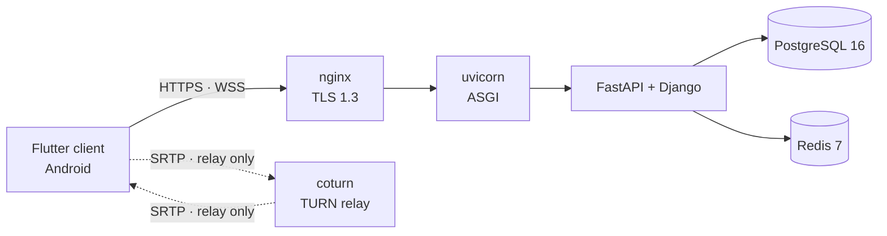

# Communication Platform

A private, self-hosted messaging platform with end-to-end encrypted direct messages and
group chats, an Android client, and audio-only voice rooms.

> **Status: work in progress.** The project is in private, invite-only testing.
> It has yet to undergo an external security audit and is unsuitable for safety-critical use.

## Why it exists

The project is designed for small groups that want to run their own messaging service.
A single VPS hosts the service and its voice relay. The Android app uses its provisioned
server and private certificate authority, with zero runtime reliance on third-party push
services, CDNs, public STUN/TURN servers, or external APIs.

## What it does

- Direct messages between two users.
- Group chats for up to 50 members, including the creator.
- Encrypted file, photo, and supported video attachments in direct chats and Saved Messages.
- Audio-only voice rooms over a self-hosted coturn relay. WebRTC carries audio in a mesh
  of device-to-device connections encrypted with DTLS-SRTP.

See the [voice architecture decision](docs/architecture/decisions/0021-relayed-webrtc-mesh-and-no-server-room.md)
and the [Android voice test record](frontend/docs/validation/voice-mesh/2026-10-05/README.md).

## Security model

Content — messages, attachments, and group state — is encrypted on the client. The server is a blind relay: it stores and routes opaque, padded ciphertext and
public keys, and it enforces nothing security-relevant. Cross-signing material and
device-list records pass through as blobs it never parses or verifies; every check that
matters happens client-side, against keys the server has never held. No
content-encryption key ever reaches the server, though it does hold infrastructure
secrets — the TLS private key, the JWT signing key, the Django secret key, and the TURN
shared secret. Group chats are pairwise: a message is encrypted
once per member device, and the server keeps no roster, group object, or group key.

The honest limit: an adversary holding live root on the box can watch which authenticated
connection deposits into and collects from each device's queue, which is enough to
reconstruct who talks to whom and when. The social graph and the timing of communication
are not protected against that adversary, and a single-box architecture cannot protect
them.

Full threat model, key inventory, and residual risk:
[docs/security/SECURITY.md](docs/security/SECURITY.md).

## Architecture

| Layer | Technology |
|---|---|
| Client | Flutter 3.44.7, Dart 3.12.2 — Android only |
| Server | Python 3.12, Django 6.0, FastAPI on uvicorn |
| Database | PostgreSQL 16, loopback only |
| Cache, fan-out bus and live state | Redis 7, loopback only |
| Voice | WebRTC mesh between devices, keyed by DTLS-SRTP, relayed by self-hosted coturn |
| Edge | nginx, TLS 1.3 under a pre-distributed private CA |

## Maintainers and repository layout

| Path | Maintainer | Contributions |
|---|---|---|
| [`backend/`](backend/) | [Nima Shadloo](https://github.com/n-shadloo) | Developed the FastAPI and Django backend and led the system architecture and deployment. The backend covers account and device APIs, message and attachment relay, the WebSocket gateway, the operator admin panel, and single-VPS deployment tooling. |
| [`frontend/`](frontend/) | [realSeyed](https://github.com/realSeyed) | Developed the Flutter app for Android, including the Rust-backed client cryptography, device enrollment and contact verification, encrypted local storage and sync, direct and group chat, attachments, and audio rooms. Built the English and Persian interfaces and the Android build and signing tooling. |

`backend/vendor/wheels` is the offline wheel cache, and it is not tracked in git. The
cache lets the operator install and rebuild the server without internet access. The
operator prepares it on the VPS with [`backend/ops/vendor.sh`](backend/ops/vendor.sh).
[`backend/ops/offline_install.sh`](backend/ops/offline_install.sh) then installs from it
with `--no-index` and `--require-hashes`.

## Documentation

| Document | Covers |
|---|---|
| [backend/README.md](backend/README.md) | Protocol and transport, authentication, the WebSocket gateway, attachments, padding buckets, retention, the full environment-variable table, and local development |
| [frontend/README.md](frontend/README.md) | Android toolchain, build environments, signing, and verification |
| [docs/security/SECURITY.md](docs/security/SECURITY.md) | Threat model, the precise key invariant, what a host compromise exposes, and residual risk |
| [docs/client/CLIENT_CONTRACT.md](docs/client/CLIENT_CONTRACT.md) | The client-side half of every security property; authoritative for client implementations |
| [docs/client/CLIENT_CONTACTS_AND_TRUST.md](docs/client/CLIENT_CONTACTS_AND_TRUST.md) | Binding beside the contract: contacts, the contact code, verification by both people, the profile key, and what a file carries |
| Per-app API reference | [accounts](backend/accounts/API.md) · [devices](backend/devices/API.md) · [vault](backend/vault/API.md) · [messaging](backend/messaging/API.md) · [attachments](backend/attachments/API.md) · [realtime](backend/realtime/API.md) · [core](backend/core/API.md) |
| [backend/openapi.json](backend/openapi.json) | The same surface as a generated OpenAPI document: every path, method, payload shape and error status. CI fails a change that does not regenerate it |
| [API_CHANGES.md](API_CHANGES.md) | Everything a client can observe that has moved since the pre-rebuild state, and what the client does about each one |
| [docs/architecture/DESIGN-RECORD.md](docs/architecture/DESIGN-RECORD.md) | The system of record for the architecture: the positions table, the assumption ledger, the deferral list, and the decision log |
| [docs/architecture/GROUND-TRUTH.md](docs/architecture/GROUND-TRUTH.md) | The measured facts of the deployment: topology, configuration deviations, scale facts, and the domain rules the code must hold |
| [docs/architecture/decisions/](docs/architecture/decisions/) | One ADR for each architecture decision |
| [ACCEPTED_RISKS.md](ACCEPTED_RISKS.md) | Every risk the project has looked at and decided to carry, each with what it exposes, what reduces it, and the event that ends the acceptance |
| [REJECTED_PROPOSALS.md](REJECTED_PROPOSALS.md) | Every defence the project considered and turned down, each with what it would have protected, why it is not built, and the event that reopens it |
| [CLIENT_WORK.md](CLIENT_WORK.md) | Client follow-up work from server changes |
| [docs/admin/PANEL-RECORD.md](docs/admin/PANEL-RECORD.md) | The system of record for the operator back office: the pinned release, the override ledger, the role model, and the deferrals |
| [backend/ops/RUNBOOK.md](backend/ops/RUNBOOK.md) | The operator runbook: host setup, the offline install, the database, the units, nginx and TLS, coturn, the checks after a deploy, the rollback, and the maintenance timer |
| [frontend/docs/README.md](frontend/docs/README.md) | Index of the client engineering contract: threat model, cryptographic protocol, UI specification, sync engine, and platform notes |
| [.github/SECURITY.md](.github/SECURITY.md) | How to report a vulnerability privately, and which findings are in scope. It states the scope and routes the reader to [docs/security/SECURITY.md](docs/security/SECURITY.md) for what the system claims |
| [.github/CONTRIBUTING.md](.github/CONTRIBUTING.md) | The split between the two maintainers, and which side of it a change belongs to |

## Current status

**Server.** The backend includes account and device registration, device-scoped JWT
authentication, cross-signing and classical + ML-KEM
prekey distribution, the durable envelope queue, bucketed attachments, and the `/ws`
gateway. The gateway relays call signalling, and `POST /api/v1/me/relay` issues
short-lived coturn credentials. The Android client manages voice-room state.

The backend exposes a versioned `v1` API. CI checks the generated
[OpenAPI contract](backend/openapi.json), and [API_CHANGES.md](API_CHANGES.md) records
changes that affect clients.

**Client.** See the [frontend status matrix](frontend/docs/STATUS.md) for implemented
behavior, validation evidence, and release gaps.

The [client contract](docs/client/CLIENT_CONTRACT.md) defines the requirements a client
must meet for the security properties to hold.

## License

Apache License 2.0 — see [LICENSE](LICENSE). Copyright 2026 Nima Shadloo.

Third-party components keep their own terms. The Python packages pinned in
`backend/requirements/` stay under their respective licenses;
`backend/ops/gen_sbom.sh` writes a CycloneDX document of that set, with every name,
version and digest, from `backend/requirements/prod.txt`.

Two of those packages ship files this deployment serves to a browser, so their own
bundled third-party assets are served with them. `django-unfold` (MIT) renders the
admin panel, and `python manage.py collectstatic` publishes the following from
inside it:

| Bundled asset | Licence |
|---|---|
| Alpine.js, with its anchor, focus, persist, resize and sort plugins | MIT |
| Chart.js | MIT |
| htmx | 0BSD |
| Inter (four `woff2` weights) | SIL OFL 1.1 |
| Material Symbols Outlined (`woff2`) | Apache-2.0 |

Each carries its own `LICENSE` file inside the package. The deployment serves all of
these assets from its own host.

On the client side, `frontend/assets/fonts/vazirmatn/` bundles the Vazirmatn font
under SIL OFL 1.1.
